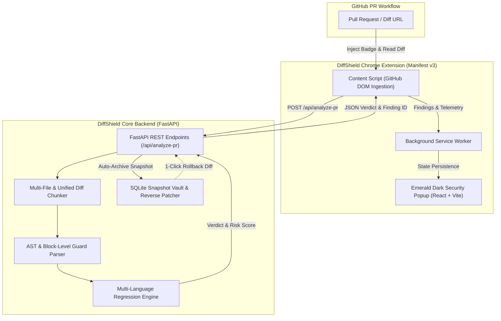

# 🛡️ DiffShield

[](https://fastapi.tiangolo.com)
[](https://www.python.org/)
[](https://reactjs.org/)
[](https://www.typescriptlang.org/)
[](https://developer.chrome.com/docs/extensions/mv3/)
[](LICENSE)

> **Next-Generation AppSec Browser Extension & Backend Engine**  
> Detects malicious pull requests, silent supply-chain tampering, and vulnerability reintroductions by identifying the accidental or intentional removal of security guards across multi-language codebases.

---

## 📌 Table of Contents

- [Overview](#-overview)
- [The Problem: Silent Security Regressions](#-the-problem-silent-security-regressions)
- [System Architecture](#-system-architecture)
- [Core Features](#-core-features)
- [Supported Languages & Vulnerability Matrix](#-supported-languages--vulnerability-matrix)
- [Repository Structure](#-repository-structure)
- [Quick Start Guide](#-quick-start-guide)
  - [1. Backend Setup](#1-backend-setup)
  - [2. Chrome Extension Setup](#2-chrome-extension-setup)
  - [3. Running the Verification Suite](#3-running-the-verification-suite)
- [API Reference](#-api-reference)
- [Testing & Quality Assurance](#-testing--quality-assurance)
- [Roadmap](#-roadmap)
- [License](#-license)

---

## 🔎 Overview

**DiffShield** acts as an active security defense line on pull requests. While traditional SAST scanners look for known static signatures, attackers and well-meaning contributors often silently undo security controls—such as removing input sanitizers, bypassing authentication checks, dropping rate limiters, or disabling CSRF protections.

DiffShield uses a **deterministic AST and block-level diff parser** alongside a **historical patch intelligence engine** to detect when a security guard around a vulnerable sink has been stripped or degraded. If a regression is found, DiffShield alerts security reviewers directly in GitHub and provides **1-click rollback snapshots**.

---

## ⚠️ The Problem: Silent Security Regressions

Modern software supply-chain attacks frequently occur through subtle, incremental PRs:
1. **Refactoring Disasters**: A developer refactors an endpoint and removes an "unnecessary" `DOMPurify.sanitize()` or an `ast.literal_eval()` guard, re-opening CVE-level vulnerabilities.
2. **Trojan PRs**: Attackers submit legitimate-looking feature PRs that subtly dismantle bounds checking or downgrade secure cryptography (e.g., swapping AES-256 for DES/MD5).
3. **Guard Stripping**: Traditional linters often fail to flag the absence of a guard around an existing call site because the call site itself isn't newly added code.

DiffShield specifically monitors **diff delta boundaries** to verify that security guards enclosing critical sinks are preserved.

---

## 🏗️ System Architecture



---

## ⚡ Core Features

- 🔍 **Deterministic AST & Block Guard Parsing**: Multi-line and block analysis evaluates whether an enclosing `if`, `try/catch`, sanitizer, or validator was removed from around sensitive sinks.
- 🌐 **Comprehensive Multi-Language Coverage**: Native security guard models for **JavaScript, TypeScript, Python, Java, C/C++, HTML, and CSS**.
- 🛡️ **Cross-Language Vulnerability Detection**:
  - SQL Injection (raw queries, template literals, unescaped concats)
  - SSRF (unrestricted outbound requests, missing IP/origin allowlists)
  - Path Traversal (unvalidated filesystem joins, missing realpath guards)
  - Weak Cryptography (downgrades to MD5, SHA1, DES)
  - Prototype Pollution & Code Injection (`eval`, `exec`, `new Function`)
  - XML External Entity (XXE) and Insecure Deserialization (Pickle, YAML, Java ObjectInputStream)
- 💾 **Snapshot Vault & 1-Click Rollback**: Automatically archives clean pre-PR baselines into an isolated SQLite vault and computes reverse patches for instantaneous rollback of dangerous PRs.
- 🎨 **Sleek Emerald Dark Extension UI**: Manifest v3 extension with glassmorphism design, threat badges, severity meters, and detailed remediation advice.
- 🧪 **Exhaustive Automated Verification**: Over 74 test assertions covering diff parsing, edge-case collisions, and rollback integrity.

---

## 📊 Supported Languages & Vulnerability Matrix

| Category / Attack Vector | CWE / CVE | Supported Languages | Detection Logic |
| :--- | :--- | :--- | :--- |
| **Prototype Pollution** | CVE-2019-10744 | JS, TS | Removal of key allowlists (`__proto__`, `constructor`) or `Object.create(null)` |
| **DOM XSS** | CWE-79 | JS, TS, HTML | Direct `innerHTML` / `outerHTML` assignments lacking sanitization (`DOMPurify`) |
| **Code Injection** | CWE-94 | JS, TS, Python | Stripping expression parsers in favor of raw `eval()`, `exec()`, or `new Function()` |
| **OS Command Injection** | CWE-78 | Python, Java, C/C++ | Switching from safe parameter arrays (`shell=False`) to raw shell execution |
| **Insecure Deserialization** | CWE-502 | Python, Java | Unsafe `pickle.loads()`, `yaml.load()`, or `readObject()` without type filtering |
| **XML External Entity (XXE)** | CWE-611 | Java, Python | Disabling XML parser entity resolution guards (`FEATURE_SECURE_PROCESSING`) |
| **Memory Safety / Buffer Overflow** | CWE-120 | C, C++ | Replacing bounded functions (`strncpy`, `snprintf`) with unsafe calls (`strcpy`, `gets`) |
| **SQL Injection** | CWE-89 | Cross-Language | Removing parameterized queries in favor of raw string interpolation |
| **SSRF** | CWE-918 | Cross-Language | Deleting IP allowlists or hostname validation before outbound HTTP requests |
| **Path Traversal** | CWE-22 | Cross-Language | Unsanitized directory joining without `resolve()` or boundary checking |
| **Weak Cryptography** | CWE-327 | Cross-Language | Downgrading cipher suites or hashing to MD5, SHA1, or DES |
| **CSS Injection & Clickjacking** | CWE-1021 | HTML, CSS | Unsafe iframe framing, lack of CSP frame-ancestors, or CSS attribute sniffers |

---

## 📁 Repository Structure

```text
diff-shield/
├── backend/
│   ├── block_parser.py         # Multi-language AST block parser & language detector
│   ├── regression_engine.py    # Rule-based guard regression & CVE detection engine
│   ├── snapshot_vault.py       # SQLite snapshot archiving & 1-click rollback generator
│   ├── main.py                 # FastAPI application & GitHub PR fetching endpoints
│   ├── test_diffshield.py      # Automated test suite (74 unit & integration checks)
│   └── requirements.txt        # Backend Python dependencies
├── detection-engine/
│   ├── analyzers/              # Deep AST & diff analyzers
│   ├── vulnerability_intel/    # Known CVE patch intelligence database & schemas
│   └── tests/                  # Detection engine unit tests
├── extension/
│   ├── public/
│   │   ├── manifest.json       # Chrome Manifest v3 specification
│   │   ├── content.js          # DOM injector & GitHub PR diff hook
│   │   └── background.js       # Extension service worker & threat state manager
│   ├── src/                    # React + TypeScript + Vite extension popup
│   │   ├── App.tsx             # Emerald Dark dashboard component
│   │   └── services/           # Finding schemas & API integration
│   ├── package.json            # Extension dependencies & scripts
│   └── vite.config.ts          # Vite build configuration
└── README.md
```

---

## 🚀 Quick Start Guide

### Prerequisites
- **Python 3.10+**
- **Node.js 18+** and **npm**
- **Google Chrome** (or any Chromium-based browser)

---

### 1. Backend Setup

1. Navigate to the backend directory:
   ```bash
   cd backend
   ```

2. (Optional) Create and activate a virtual environment:
   ```bash
   python -m venv venv
   # On Windows:
   .\venv\Scripts\activate
   # On macOS/Linux:
   source venv/bin/activate
   ```

3. Install the required dependencies:
   ```bash
   pip install -r requirements.txt
   ```

4. Start the FastAPI development server:
   ```bash
   uvicorn main:app --host 127.0.0.1 --port 8000 --reload
   ```

5. Confirm the server is healthy:
   - Navigate to `http://127.0.0.1:8000/health` or `http://127.0.0.1:8000/docs` to test via the interactive Swagger UI.

---

### 2. Chrome Extension Setup

1. Navigate to the extension directory:
   ```bash
   cd extension
   ```

2. Install dependencies and build the extension bundle:
   ```bash
   npm install
   npm run build
   ```

3. Load the unpacked extension in Chrome:
   - Open Chrome and navigate to `chrome://extensions/`
   - Enable **Developer mode** (toggle in the top-right corner)
   - Click **Load unpacked**
   - Select the **`extension/dist`** directory (do *not* select `extension/public` or `extension/`)

4. Navigate to any GitHub Pull Request (e.g., `https://github.com/owner/repo/pull/123`). The DiffShield badge will activate in your extension bar and scan the PR diff.

---

### 3. Running the Verification Suite

DiffShield comes with a comprehensive test suite covering all supported programming languages, multi-file diff chunking, collision resistance, and vault rollbacks:

```bash
cd backend
python test_diffshield.py
```

Expected output:
```text
======================================================================
DiffShield Verification Suite
======================================================================
Running tests...
Ran 74 tests in 0.42s

OK (74/74 assertions passed)
======================================================================
```

---

## 📡 API Reference

### Health Check
```http
GET /health
```
**Response:**
```json
{
  "status": "ok",
  "service": "DiffShield Security Analysis API",
  "version": "1.0.0",
  "engines": {
    "block_parser": "ready",
    "regression_engine": "ready",
    "snapshot_vault": "ready"
  }
}
```

---

### Analyze Pull Request
```http
POST /api/analyze-pr
Content-Type: application/json
```

**Request Body:**
```json
{
  "pr_url": "https://github.com/owner/repo/pull/42",
  "diff_text": "@@ -10,3 +10,2 @@\n-  if (isValid(target)) {\n     window.location = target;\n-  }",
  "repository": "owner/repo",
  "pr_number": 42,
  "file_path": "src/redirect.js",
  "clean_code": "function redirect(target) { if (isValid(target)) { window.location = target; } }"
}
```

**Response:**
```json
{
  "verdict": "VULNERABILITY_REGRESSION_DETECTED",
  "risk_score": 85,
  "quarantined": true,
  "finding": {
    "id": "DS-CWE-601-...",
    "category": "OPEN_REDIRECT",
    "cve_cwe": "CWE-601",
    "severity": "HIGH",
    "title": "Open Redirect Guard Regression",
    "remediation": "Validate redirect target against an allowlist of known-safe origins."
  },
  "snapshot_id": 1,
  "repository": "owner/repo",
  "pr_number": 42
}
```

---

### 1-Click Rollback Retrieval
```http
GET /api/rollback/{owner}/{repo}/{pr_number}
```

**Response:**
```json
{
  "found": true,
  "snapshot_id": 1,
  "repository": "owner/repo",
  "pr_number": 42,
  "original_code": "function redirect(target) { ... }",
  "reverse_patch": "--- modified.js\n+++ original.js\n@@ ...",
  "created_at": "2026-10-31T20:45:00Z"
}
```

---

## 🛡️ Security & Threat Model

DiffShield is built with an AppSec-first philosophy:
- **Zero Ingestion of Sensitive Secrets**: Analysis runs locally or within private VPC environments. Vault databases use local SQLite files that are strictly `.gitignore`'d from Git tracking.
- **Fail-Open / Fail-Closed Customization**: The backend provides deterministic risk scores allowing CI/CD systems to either warn reviewers or automatically quarantine PR merges.
- **Collision Resistance**: Regex and AST tokenizers enforce boundary delimiters to prevent false positives (e.g., distinguishing Java `DocumentBuilder` from unrelated `.newInstance()` calls, or `destination` variables from `DES` cipher suites).

---

## 🗺️ Roadmap

- [x] Multi-language AST guard regression engine (JS, TS, PY, JAVA, C/C++, HTML, CSS)
- [x] GitHub PR URL ingestion & multi-file diff chunking
- [x] SQLite Snapshot Vault & Instant Reverse Patch Generation
- [x] Emerald Dark Theme Chrome Extension (Manifest v3)
- [ ] Direct GitHub Actions CI/CD step for automated PR blocking
- [ ] GitLab & Bitbucket Server diff ingestion support
- [ ] Tree-sitter native AST integration for deeper semantic dataflow tracking

---

## 📄 License

Distributed under the **MIT License**. See [`LICENSE`](LICENSE) for more information.
