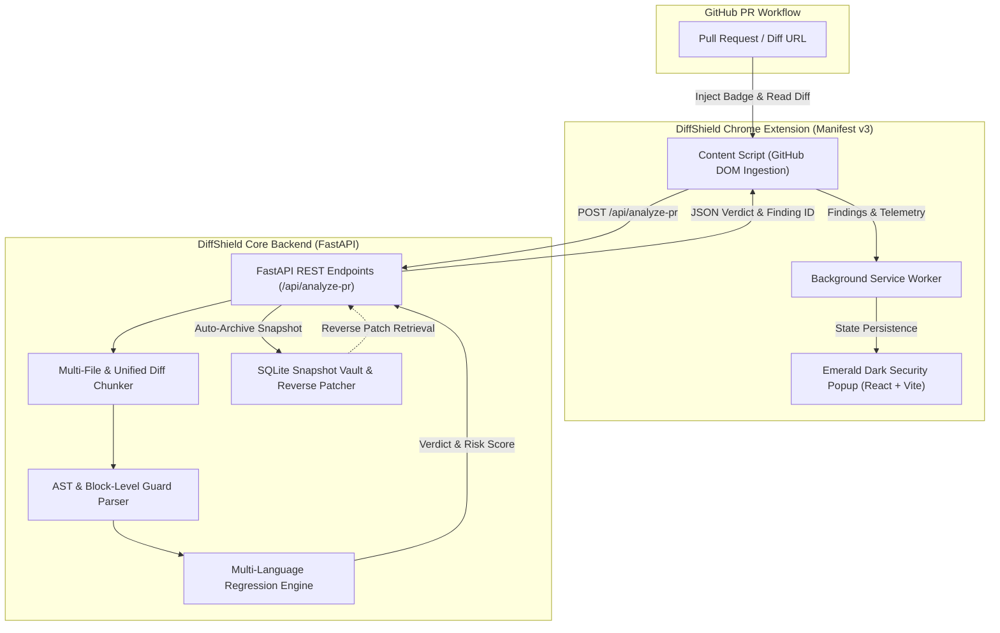

# 🛡️ DiffShield

[](https://fastapi.tiangolo.com)
[](https://www.python.org/)
[](https://reactjs.org/)
[](https://www.typescriptlang.org/)
[](https://developer.chrome.com/docs/extensions/mv3/)
[](LICENSE)

> **Next-Generation AppSec Browser Extension & Backend Engine**  
> Detects malicious pull requests, silent supply-chain tampering, and vulnerability reintroductions by identifying the accidental or intentional removal of security guards across multi-language codebases.

---

## 📌 Table of Contents

- [Overview](#-overview)
- [The Problem: Silent Security Regressions](#-the-problem-silent-security-regressions)
- [System Architecture](#-system-architecture)
- [Core Features](#-core-features)
- [Supported Languages & Vulnerability Matrix](#-supported-languages--vulnerability-matrix)
- [Repository Structure](#-repository-structure)
- [Quick Start Guide](#-quick-start-guide)
  - [1. Backend Setup](#1-backend-setup)
  - [2. Chrome Extension Setup](#2-chrome-extension-setup)
  - [3. Running the Verification Suite](#3-running-the-verification-suite)
- [Run on macOS](#run-on-macos)
- [Experimental Detection Engine](#experimental-detection-engine)
- [GitHub App & Merge Protection](#github-app--merge-protection)
- [API Reference](#-api-reference)
- [Testing & Quality Assurance](#-testing--quality-assurance)
- [Roadmap](#-roadmap)
- [License](#-license)

---

## 🔎 Overview

**DiffShield** acts as an active security defense line on pull requests. While traditional SAST scanners look for known static signatures, attackers and well-meaning contributors often silently undo security controls—such as removing input sanitizers, bypassing authentication checks, dropping rate limiters, or disabling CSRF protections.

DiffShield uses an AST and block-level diff parser alongside a historical patch intelligence engine to detect when a security guard around a vulnerable sink has been stripped or degraded. If a regression is found, DiffShield alerts security reviewers directly in GitHub and stores a reverse patch for recovery.

---

## ⚠️ The Problem: Silent Security Regressions

Modern software supply-chain attacks frequently occur through subtle, incremental PRs:
1. **Refactoring Disasters**: A developer refactors an endpoint and removes an "unnecessary" `DOMPurify.sanitize()` or an `ast.literal_eval()` guard, re-opening CVE-level vulnerabilities.
2. **Trojan PRs**: Attackers submit legitimate-looking feature PRs that subtly dismantle bounds checking or downgrade secure cryptography (e.g., swapping AES-256 for DES/MD5).
3. **Guard Stripping**: Traditional linters often fail to flag the absence of a guard around an existing call site because the call site itself isn't newly added code.

DiffShield specifically monitors **diff delta boundaries** to verify that security guards enclosing critical sinks are preserved.

---

## 🏗️ System Architecture



---

## ⚡ Core Features

- 🔍 **Deterministic AST & Block Guard Parsing**: Multi-line and block analysis evaluates whether an enclosing `if`, `try/catch`, sanitizer, or validator was removed from around sensitive sinks.
- 🌐 **Comprehensive Multi-Language Coverage**: Native security guard models for **JavaScript, TypeScript, Python, Java, C/C++, HTML, and CSS**.
- 🛡️ **Cross-Language Vulnerability Detection**:
  - SQL Injection (raw queries, template literals, unescaped concats)
  - SSRF (unrestricted outbound requests, missing IP/origin allowlists)
  - Path Traversal (unvalidated filesystem joins, missing realpath guards)
  - Weak Cryptography (downgrades to MD5, SHA1, DES)
  - Prototype Pollution & Code Injection (`eval`, `exec`, `new Function`)
  - XML External Entity (XXE) and Insecure Deserialization (Pickle, YAML, Java ObjectInputStream)
- 💾 **Snapshot Vault & Reverse Patches**: Archives PR diffs and computes reverse patches. A full baseline is included only when a caller supplies `clean_code`; GitHub PR scans do not fetch or store the full repository source.
- 🎨 **Sleek Emerald Dark Extension UI**: Manifest v3 extension with glassmorphism design, threat badges, severity meters, and detailed remediation advice.
- 🧪 **Automated Verification**: 75 backend checks plus focused API and detection-engine test suites.

---

## 📊 Supported Languages & Vulnerability Matrix

| Category / Attack Vector | CWE / CVE | Supported Languages | Detection Logic |
| :--- | :--- | :--- | :--- |
| **Prototype Pollution** | CVE-2019-10744 | JS, TS | Removal of key allowlists (`__proto__`, `constructor`) or `Object.create(null)` |
| **DOM XSS** | CWE-79 | JS, TS, HTML | Direct `innerHTML` / `outerHTML` assignments lacking sanitization (`DOMPurify`) |
| **Code Injection** | CWE-94 | JS, TS, Python | Stripping expression parsers in favor of raw `eval()`, `exec()`, or `new Function()` |
| **OS Command Injection** | CWE-78 | Python, Java, C/C++ | Switching from safe parameter arrays (`shell=False`) to raw shell execution |
| **Insecure Deserialization** | CWE-502 | Python, Java | Unsafe `pickle.loads()`, `yaml.load()`, or `readObject()` without type filtering |
| **XML External Entity (XXE)** | CWE-611 | Java, Python | Disabling XML parser entity resolution guards (`FEATURE_SECURE_PROCESSING`) |
| **Memory Safety / Buffer Overflow** | CWE-120 | C, C++ | Replacing bounded functions (`strncpy`, `snprintf`) with unsafe calls (`strcpy`, `gets`) |
| **SQL Injection** | CWE-89 | Cross-Language | Removing parameterized queries in favor of raw string interpolation |
| **SSRF** | CWE-918 | Cross-Language | Deleting IP allowlists or hostname validation before outbound HTTP requests |
| **Path Traversal** | CWE-22 | Cross-Language | Unsanitized directory joining without `resolve()` or boundary checking |
| **Weak Cryptography** | CWE-327 | Cross-Language | Downgrading cipher suites or hashing to MD5, SHA1, or DES |
| **CSS Injection & Clickjacking** | CWE-1021 | HTML, CSS | Unsafe iframe framing, lack of CSP frame-ancestors, or CSS attribute sniffers |

---

## 📁 Repository Structure

```text
diff-shield/
├── backend/
│   ├── block_parser.py         # Multi-language AST block parser & language detector
│   ├── regression_engine.py    # Rule-based guard regression & CVE detection engine
│   ├── snapshot_vault.py       # SQLite snapshot archiving & reverse-patch generator
│   ├── main.py                 # FastAPI application & GitHub PR fetching endpoints
│   ├── test_diffshield.py      # Automated test suite (75 unit & integration checks)
│   └── requirements.txt        # Backend Python dependencies
├── detection-engine/           # Experimental package; not used by the backend
│   ├── analyzers/              # Deep AST & diff analyzers
│   ├── vulnerability_intel/    # Known CVE patch intelligence database & schemas
│   └── tests/                  # Detection engine unit tests
├── extension/
│   ├── public/
│   │   ├── manifest.json       # Chrome Manifest v3 specification
│   │   ├── content.js          # DOM injector & GitHub PR diff hook
│   │   └── background.js       # Extension service worker & threat state manager
│   ├── src/                    # React + TypeScript + Vite extension popup
│   │   ├── App.tsx             # Emerald Dark dashboard component
│   │   └── services/           # Finding schemas & API integration
│   ├── package.json            # Extension dependencies & scripts
│   └── vite.config.ts          # Vite build configuration
└── README.md
```

---

## 🚀 Quick Start Guide

### Prerequisites
- **Python 3.12 or 3.13** (stable releases)
- **Node.js 18+** and **npm**
- **Google Chrome** (or any Chromium-based browser)

---

### 1. Backend Setup

1. Navigate to the backend directory:
   ```bash
   cd backend
   ```

2. (Optional) Create and activate a virtual environment:
   ```bash
   python -m venv venv
   # On Windows:
   .\venv\Scripts\activate
   # On macOS/Linux:
   source venv/bin/activate
   ```

3. Install the required dependencies:
   ```bash
   pip install -r requirements.txt
   ```

4. Start the FastAPI development server:
   ```bash
   uvicorn main:app --host 127.0.0.1 --port 8000 --reload
   ```

5. Confirm the server is healthy:
   - Navigate to `http://127.0.0.1:8000/health` or `http://127.0.0.1:8000/docs` to test via the interactive Swagger UI.

---

### 2. Chrome Extension Setup

1. Navigate to the extension directory:
   ```bash
   cd extension
   ```

2. Install dependencies and build the extension bundle:
   ```bash
   npm ci
   npm run build
   ```

3. Load the unpacked extension in Chrome:
   - Open Chrome and navigate to `chrome://extensions/`
   - Enable **Developer mode** (toggle in the top-right corner)
   - Click **Load unpacked**
   - Select the **`extension/dist`** directory (do *not* select `extension/public` or `extension/`)

4. Navigate to any GitHub Pull Request (e.g., `https://github.com/owner/repo/pull/123`). The DiffShield badge will activate in your extension bar and scan the PR diff.

---

### 3. Running the Verification Suite

DiffShield comes with a comprehensive test suite covering all supported programming languages, multi-file diff chunking, collision resistance, and vault rollbacks:

```bash
cd backend
pip install -r requirements-dev.txt
python test_diffshield.py
python -m pytest test_api.py test_ci_check.py test_quarantine.py test_github_app.py -q

cd ../detection-engine
python -m pytest -q
```

`backend/requirements-dev.txt` installs the backend dependencies plus pytest.
`detection-engine/requirements.txt` states that the experimental package has
no third-party dependencies.

---

## Run on macOS

Use Python 3.12 or 3.13 for the backend (not a pre-release Python version):

```bash
cd backend
python3.12 -m venv .venv
source .venv/bin/activate
pip install -r requirements.txt
python -m uvicorn main:app --host 127.0.0.1 --port 8000
# check: curl http://127.0.0.1:8000/health
```

In another terminal, build and load the extension:

```bash
cd extension
npm ci
npm run build
# Chrome -> chrome://extensions -> Developer mode -> Load unpacked -> choose extension/dist
```

## Experimental Detection Engine

`detection-engine/` is an experimental, standalone package and is not imported
or used by the FastAPI backend. Its tests can be run separately as shown above.
It currently has no third-party Python dependencies.

## GitHub Actions Merge Protection

The workflow in
`.github/workflows/diffshield-security-gate.yml` creates a **DiffShield Security
Gate** check on each pull request's head commit. Enable GitHub Actions for the
repository, then create a branch protection rule for `main` and require the
status check **DiffShield Security Gate** from the **GitHub Actions** app.
Require pull requests before merging so changes cannot bypass the check by
being pushed directly to `main`.

The workflow uses `pull_request_target` so its scanner comes from trusted base
code. It only retrieves the PR diff, does not check out or execute contributor
code, and gives its scan step a token limited to reading pull requests and
writing checks. A detected regression fails the required status check. This
mode does not run the backend service or provide its persistent 12-hour
quarantine/reviewer workflow.

## Optional GitHub App Backend Integration

The backend also supports automatic PR scans and persistent quarantine through
a GitHub App. This alternative requires a backend you control that GitHub can
reach over HTTPS; the local backend on `127.0.0.1` cannot receive GitHub
webhooks. Without the App and a verified repository check, the backend reports
merge protection as `NOT_ENFORCED`.

1. Create a GitHub App with a webhook URL ending in `/api/github/webhook` and a
   webhook secret. Subscribe to the **Pull request** and **Installation**
   webhook events.
2. Grant repository permissions: **Pull requests** (read and write), **Checks**
   (read and write), **Issues** (read and write, for maintainer comments), and
   **Administration** (read, to verify required status checks). Install the App
   on each repository it should scan.
3. Configure `GITHUB_APP_ID`, `GITHUB_APP_PRIVATE_KEY`, and
   `GITHUB_WEBHOOK_SECRET` in the backend environment. The private key may use
   literal `\n` sequences for line breaks. Keep these values in a secret
   manager; never commit them. `GITHUB_TOKEN` may separately be set to increase
   the GitHub API rate limit for direct extension/API scans.
4. In each target repository's branch protection or ruleset, require the check
   **DiffShield Security Gate** and select the check produced by the DiffShield
   GitHub App. DiffShield creates this check for PR commits; a required check
   must be configured by a repository administrator.
5. Verify the setup with
   `GET /api/github/status?repository=owner/repo`. The response reports
   `ENFORCED` only when the App installation and the App-owned required check
   have both been verified for that repository's base branch. The global
   `/api/github/status` endpoint always reports `NOT_ENFORCED`, because
   enforcement is repository-specific.

The App scans pull requests when they are opened, reopened, or synchronized,
and handles installation creation/removal events. Quarantines are persisted in
SQLite (by default `backend/diffshield_quarantines.db`; override with
`DIFFSHIELD_QUARANTINE_DB`). A finding stays held for at least 12 hours and is
escalated if not reviewed; expiry does not release it.

Authorized resolution is configured separately with
`DIFFSHIELD_REVIEWER_TOKENS`, a JSON object mapping reviewer identities to
bearer tokens of at least 32 characters. For example:

```text
{"security-reviewer":"replace-with-a-random-secret-of-at-least-32-characters"}
```

Send the token as `Authorization: Bearer <token>` to
`POST /api/quarantines/{finding_id}/resolve`. This is backend-configured token
authentication, not GitHub user OAuth; protect the API and tokens accordingly.

---

## 📡 API Reference

### Health Check
```http
GET /health
```
**Response:**
```json
{
  "status": "ok",
  "service": "DiffShield Security Analysis API",
  "version": "1.0.0",
  "engines": {
    "block_parser": "ready",
    "regression_engine": "ready",
    "snapshot_vault": "ready"
  }
}
```

---

### Analyze Pull Request
```http
POST /api/analyze-pr
Content-Type: application/json
```

**Request Body:**
```json
{
  "pr_url": "https://github.com/owner/repo/pull/42"
}
```

Provide either `pr_url` or `diff_text`, not both. `pr_url` must be an HTTPS
GitHub pull-request URL. Optionally provide `clean_code` when a source baseline
is available. GitHub diffs are fetched through the GitHub API. Set `GITHUB_TOKEN`
in the backend environment to increase the API rate limit; the token is not
included in logs or responses.

**Response:**
```json
{
  "status": "QUARANTINE_HOLD",
  "is_regression": true,
  "risk_score": 92,
  "hold_hours": 12,
  "explanation": "Security guard regression detected in src/redirect.js.",
  "recommended_action": "Re-introduce the removed security guard.",
  "finding": {
    "id": "DS-1234ABCD",
    "title": "DOM XSS Guard Regression",
    "repository": "owner/repo",
    "description": "A HIGH-severity guard regression was detected.",
    "severity": "HIGH",
    "cve_cwe": "CWE-79",
    "language": "JavaScript/TypeScript",
    "file_path": "src/redirect.js",
    "dropped_categories": ["DOM_XSS"]
  },
  "all_dropped": [
    {
      "category": "DOM_XSS",
      "severity": "HIGH",
      "cve_cwe": "CWE-79",
      "title": "DOM XSS Guard Regression",
      "language": "JavaScript/TypeScript",
      "file_path": "src/render.js",
      "remediation": "Use textContent instead of innerHTML. Apply DOMPurify sanitization."
    }
  ],
  "repository": "owner/repo",
  "pr_number": 42,
  "file_path": "unknown",
  "snapshot_id": 1,
  "baseline_available": false,
  "diff_length": 1234
}
```

Risk scores are stable for a given severity. A clean scan returns `status:
PASSED`, `risk_score: 8`, and `finding: null`.

---

### Reverse Patch Retrieval
```http
GET /api/rollback/{owner}/{repo}/{pr_number}
```

**Response:**
```json
{
  "found": true,
  "id": 1,
  "repository": "owner/repo",
  "pr_number": 42,
  "file_path": "src/render.js",
  "original_code": "",
  "reverse_patch": "--- modified.js\n+++ original.js\n@@ ...",
  "baseline_available": false,
  "captured_at": "2026-10-31T20:45:00Z",
  "message": "No baseline source code was supplied; the reverse patch is available. Apply reverse_patch with `git apply` to rollback."
}
```

This endpoint returns a reverse patch; it does not apply the patch to a GitHub
repository automatically.

---

## 🛡️ Security & Threat Model

DiffShield is built with an AppSec-first philosophy:
- **Zero Ingestion of Sensitive Secrets**: Analysis runs locally or within private VPC environments. Vault databases use local SQLite files that are strictly `.gitignore`'d from Git tracking.
- **Fail-Open / Fail-Closed Customization**: The backend provides deterministic risk scores allowing CI/CD systems to either warn reviewers or automatically quarantine PR merges.
- **Collision Resistance**: Regex and AST tokenizers enforce boundary delimiters to prevent false positives (e.g., distinguishing Java `DocumentBuilder` from unrelated `.newInstance()` calls, or `destination` variables from `DES` cipher suites).

---

## 🗺️ Roadmap

- [x] Multi-language AST guard regression engine (JS, TS, PY, JAVA, C/C++, HTML, CSS)
- [x] GitHub PR URL ingestion & multi-file diff chunking
- [x] SQLite Snapshot Vault & Instant Reverse Patch Generation
- [x] Emerald Dark Theme Chrome Extension (Manifest v3)
- [ ] Direct GitHub Actions CI/CD step for automated PR blocking
- [ ] GitLab & Bitbucket Server diff ingestion support
- [ ] Tree-sitter native AST integration for deeper semantic dataflow tracking

---

## 📄 License

Distributed under the **MIT License**. See [`LICENSE`](LICENSE) for more information.
